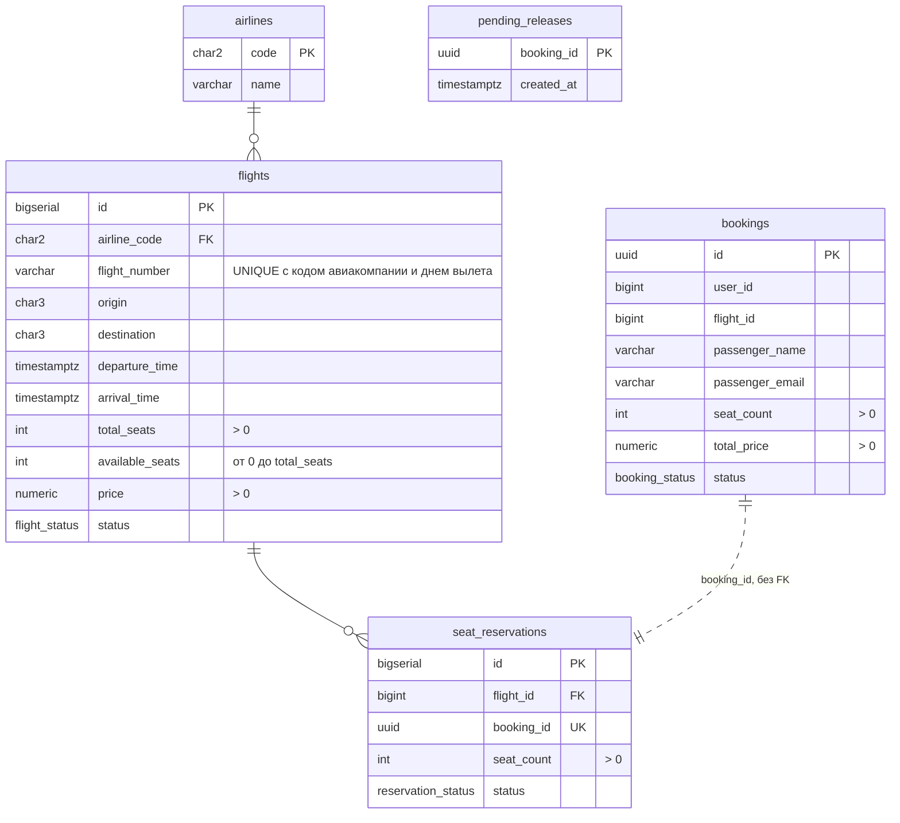

# Flight Booking: gRPC + Redis

## Запуск

```
docker compose up -d --build
```

Поднимаются две бд с миграциями, redis (мастер, реплика, три sentinel), flight и booking. Сервисы стартуют только после успешных миграций  
Swagger: http://localhost:8000/docs  
Для кастом порта
```
APP_PORT=8088 docker compose up -d --build
```

Стоп

```
docker compose down -v
```

## Gen код

Делается при сборке образа. Посмотреть:

```
docker compose run --rm --no-deps flight cat flight_pb2.py
docker compose run --rm --no-deps flight cat flight_pb2_grpc.py
```

## ER-диаграмма



bookings и pending_releases лежат в бд booking, остальное в бд flight. Бронь и резервация связаны по booking_id, FK нет, базы разные

## Решения

- Цена в proto строкой, во float теряются копейки
- id брони генерится до резерва мест и уходит во flight как ключ идемпотентности: ретрай не создаст вторую резервацию
- Авиакомпания в отдельной таблице: SU1234 хранится как код SU и номер 1234, иначе название зависело бы от номера рейса и ломало 3NF
- Перед резервом бронь пишет запись в pending_releases и удаляет ее в одной транзакции с созданием брони. Отмена ставит CANCELLED и пишет такую же запись в одной транзакции. Если flight точно отказал, запись сразу удаляется. Фоновая задача раз в 10 секунд возвращает места по записям старше минуты. Пока места возвращаются, запись заблокирована, и бронь по ней не запишется. Так места не теряются, если резерв прошел, а бронь не записалась, если клиент отвалился или если flight лежал во время отмены
- total_price это снимок цены на момент брони, цена рейса может поменяться
- Кеш живет 5 минут. Изменение рейса, резерв и отмена до коммита ставят на рейс и поиски с ним метку на 5 секунд, а кеш пишется только если ключа нет. Поэтому чтение из бд, начатое до изменения, не вернет в кеш старые данные
- Если redis лежит, чтение идет в бд, а изменения откатываются с UNAVAILABLE, пока sentinel не переключит мастера: иначе в кеше остались бы старые данные
- Три sentinel с кворумом 2: падение мастера подтверждают двое, failover переживает потерю одного sentinel
- Retry: 3 попытки с паузами 100 и 200ms
- Circuit breaker: 5 ошибок за 30 секунд открывают, через 15 секунд одна пробная попытка. Настраивается в docker-compose.yml
- UpdateFlight меняет цену и/или статус рейса, вызывается только по gRPC

## Демо

```
API=localhost:8000
```

Рейсы: поиск, по дате, нет рейса, нет destination. Отмененный SU1238 в поиск не попадает

```
curl "$API/flights?origin=SVO&destination=LED"
curl "$API/flights?origin=SVO&destination=LED&date=2026-12-01"
curl $API/flights/1
curl $API/flights/999
curl "$API/flights?origin=SVO"
```

Бронь, список, отмена, повторная отмена. Места у рейса 1 списываются и возвращаются

```
ID=$(curl -s $API/bookings --json '{"user_id":1,"flight_id":1,"passenger_name":"Ivan Ivanov","passenger_email":"ivan@mail.ru","seat_count":2}' | jq -r .id)
curl $API/bookings/$ID
curl "$API/bookings?user_id=1"
curl $API/flights/1
curl -X POST $API/bookings/$ID/cancel
curl -X POST $API/bookings/$ID/cancel
curl $API/flights/1
```

Ошибки: нет рейса, рейс отменен, мало мест, кривое тело, нет брони

```
curl $API/bookings --json '{"user_id":1,"flight_id":999,"passenger_name":"A","passenger_email":"a@mail.ru","seat_count":1}'
curl $API/bookings --json '{"user_id":1,"flight_id":4,"passenger_name":"A","passenger_email":"a@mail.ru","seat_count":1}'
curl $API/bookings --json '{"user_id":1,"flight_id":1,"passenger_name":"A","passenger_email":"a@mail.ru","seat_count":500}'
curl $API/bookings --json '{"user_id":1}'
curl $API/bookings/00000000-0000-0000-0000-000000000000
```

Последнее место: у рейса 5 свободно одно, 5 броней сразу. Один 201, четыре 409

```
seq 5 | xargs -P5 -I{} curl -s -o /dev/null -w '%{http_code}\n' $API/bookings --json '{"user_id":2,"flight_id":5,"passenger_name":"P{}","passenger_email":"p{}@mail.ru","seat_count":1}'
```

Кеш: первый запрос miss, второй hit, у ключа TTL 300. Бронь ставит на рейс метку stale на 5 секунд, следующий запрос снова miss

```
curl $API/flights/2
curl $API/flights/2
docker compose exec redis redis-cli ttl flight:2
curl $API/bookings --json '{"user_id":3,"flight_id":2,"passenger_name":"A","passenger_email":"a@mail.ru","seat_count":1}'
docker compose exec redis redis-cli get flight:2
curl $API/flights/2
docker compose logs flight | grep flight:2
```

gRPC напрямую через grpcurl:

```
grpc() { docker run --rm -v $PWD/proto:/proto --network soa-hw-3_default fullstorydev/grpcurl -plaintext -import-path /proto -proto flight.proto "$@"; }
```

Без ключа и с неверным ключом UNAUTHENTICATED

```
grpc -d '{"id":1}' flight:50051 flight.v1.FlightService/GetFlight
grpc -H 'x-api-key: wrong' -d '{"id":1}' flight:50051 flight.v1.FlightService/GetFlight
```

Два одинаковых резерва дают одну резервацию, места списываются один раз

```
K='x-api-key: flight-secret-key'
grpc -H "$K" -d '{"flight_id":2,"seat_count":3,"booking_id":"11111111-1111-1111-1111-111111111111"}' flight:50051 flight.v1.FlightService/ReserveSeats
grpc -H "$K" -d '{"flight_id":2,"seat_count":3,"booking_id":"11111111-1111-1111-1111-111111111111"}' flight:50051 flight.v1.FlightService/ReserveSeats
grpc -H "$K" -d '{"id":2}' flight:50051 flight.v1.FlightService/GetFlight
```

Изменение рейса: новая цена сразу видна в REST, потом отмена рейса убирает его из поиска. Кривая цена INVALID_ARGUMENT

```
curl $API/flights/3
grpc -H "$K" -d '{"id":3,"price":"6000.00"}' flight:50051 flight.v1.FlightService/UpdateFlight
curl $API/flights/3
grpc -H "$K" -d '{"id":3,"status":"CANCELLED"}' flight:50051 flight.v1.FlightService/UpdateFlight
curl "$API/flights?origin=SVO&destination=LED"
grpc -H "$K" -d '{"id":3,"price":"-1"}' flight:50051 flight.v1.FlightService/UpdateFlight
```

Retry и circuit breaker: flight лежит, первые 5 запросов идут с ретраями, потом breaker открывается и 6-й сразу получает 503. Через 15 секунд после подъема flight breaker закрывается. Переходы видно в логах booking

```
docker compose stop flight
for i in 1 2 3 4 5 6; do curl -s -w ' %{http_code} %{time_total}s\n' $API/flights/1; done
docker compose start flight
sleep 15; curl $API/flights/1
docker compose logs booking
```

Отмена, пока flight лежит: бронь сразу CANCELLED, места возвращаются фоновой задачей примерно через минуту

```
ID=$(curl -s $API/bookings --json '{"user_id":5,"flight_id":2,"passenger_name":"A","passenger_email":"a@mail.ru","seat_count":3}' | jq -r .id)
docker compose stop flight
curl -X POST $API/bookings/$ID/cancel
docker compose start flight
sleep 80
docker compose logs booking | grep release
curl $API/flights/2
```

Sentinel: падают мастер и один из sentinel. Пока мастера нет, чтение идет в бд, а бронь получает 503. Через несколько секунд два оставшихся sentinel делают мастером реплику, кеш и брони снова работают

```
docker compose exec redis-sentinel-1 redis-cli -p 26379 sentinel ckquorum mymaster
docker compose exec redis-sentinel-1 redis-cli -p 26379 sentinel get-master-addr-by-name mymaster
docker compose stop redis redis-sentinel-3
curl $API/flights/1
curl $API/bookings --json '{"user_id":6,"flight_id":1,"passenger_name":"A","passenger_email":"a@mail.ru","seat_count":1}'
sleep 12
docker compose exec redis-sentinel-1 redis-cli -p 26379 sentinel get-master-addr-by-name mymaster
curl $API/flights/1
curl $API/bookings --json '{"user_id":6,"flight_id":1,"passenger_name":"A","passenger_email":"a@mail.ru","seat_count":1}'
docker compose logs flight
docker compose start redis redis-sentinel-3
```

## БД

```
docker compose exec -T flight-db psql -U postgres flight -c 'SELECT * FROM flights' -c 'SELECT * FROM seat_reservations'
docker compose exec -T booking-db psql -U postgres booking -c 'SELECT * FROM bookings' -c 'SELECT * FROM pending_releases'
```

Зайти в psql руками:

```
docker compose exec flight-db psql -U postgres flight
```

```
docker compose exec booking-db psql -U postgres booking
```

## Логи

cache hit/miss во flight, ретраи, состояния breaker и возврат мест в booking

```
docker compose logs -f flight booking
```
